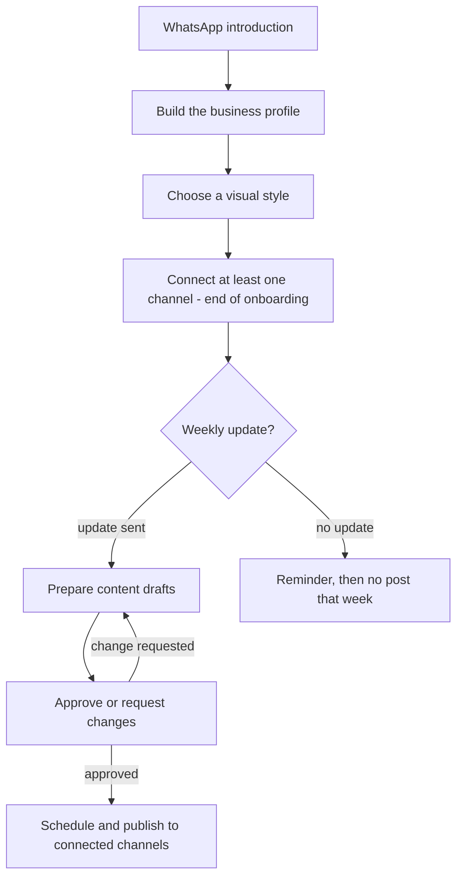
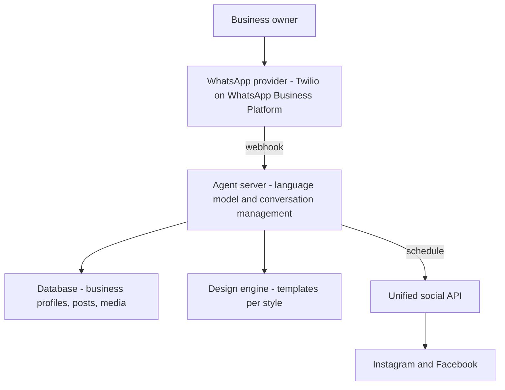

# Postly Product Spec (PRD)

Postly is an AI agent that manages Instagram and Facebook for small business owners through WhatsApp. This spec covers the process, the context held for each business, the architecture decisions, and what the agent can and cannot do in Phase 1.

## Product overview

Postly writes, designs, and publishes 2 to 5 posts a week on Instagram and Facebook for small business owners. All communication with the owner happens in WhatsApp, so no app or additional interface is needed.

| Topic | Definition |
| --- | --- |
| Target audience | Independent small business owners, mostly with a weak or inconsistent social media presence |
| Communication channel | WhatsApp, through a third-party provider in Phase 1 |
| Publishing channels | Instagram and Facebook in Phase 1, and connecting one of them is enough; more networks later |
| Output | 2 to 5 posts a week, as set in the business profile; each approved post goes to all connected channels and counts as one post |
| Publishing | Through a unified social API, connected to the customer's Instagram business account and Facebook Page |
| Guiding principle | Nothing goes live without the owner's explicit approval |

## Product flow

## WhatsApp onboarding

1. Opening: the agent introduces itself and explains how the service works and how long onboarding will take.
2. Introduction: plain-language questions, one or two per message, fill the required profile fields. The owner can answer by text or voice message.
3. Brand assets: the agent collects the logo, photos of the business and products, and any existing colors or design language.
4. Style selection: the agent sends a sample post about the business in each of the three styles, and the owner chooses one.
5. Profile summary and approval: the agent sends a short summary of what it understood, and the owner corrects or approves it.
6. Channel connection (last step): the owner connects at least one channel through a link: an Instagram business account, a Facebook Page, or both, right before publishing starts. See Connecting Instagram and Facebook.

Channel connection comes last so the owner has already seen value in the sample posts before the most cumbersome technical step.

## Business profile: the context the agent holds

Each business has a separate profile, and one customer's information is never used for another business. The profile has three parts: what the owner must provide, what has a default, and what the agent learns over time.

### Required fields and defaults

| Field | What is asked | Required | Default |
| --- | --- | --- | --- |
| Business name and field | What the business sells or provides, and its main products | Yes | None |
| Location and hours | City, address, hours, and pickup or delivery | Yes | None |
| Target audience | Who the customers are: age, neighborhood or area, and why they come | Yes | Local residents |
| What makes the business different | Why customers choose it over a competitor | Yes | None |
| Post language | Hebrew, Arabic, English, Russian, or a mix | No | Hebrew |
| Tone of voice | Formal, warm and familial, or humorous; masculine, feminine, or plural address; emoji use | No | Warm, plural address |
| Content types | Products, promotions, behind the scenes, tips, holidays and events, customer testimonials | No | Mix of products and promotions |
| Formats | Single post or carousel | No | Single post |
| Publishing channels | Instagram, Facebook, or both; one channel is enough | Yes | None |
| Publishing frequency | Posts per week, from 2 to 5 | No | 3 per week |
| Publishing days and hours | Asked during onboarding: whether to publish on Shabbat and holidays, and on which days and hours | No | No publishing on Shabbat and holidays |
| Logo and brand colors | Logo file and fixed colors, if any | No | Business name as text and style colors |
| Visual style | One of the three styles | Yes | None |
| Call to action | What the customer should do: visit, call, send a message, order online | No | Visit the store |
| Contact details | Phone, WhatsApp, website, or order link | No | None |
| Forbidden topics and language | Topics, words, or competitors not to mention | No | No politics, no competitor comparisons |
| Fixed hashtags | Hashtags of the business or city | No | Agent chooses by field and location |
| Approving contact | One number that approves posts in WhatsApp | Yes | The person who completed onboarding |

### Context that updates automatically

- Post history: what was published, when, and on which channel, to avoid repeating an idea.
- Preferences from corrections: every change the owner requests (for example no exclamation marks, or shorter captions) is saved immediately as a rule. A later phase will let owners define what is one-time and what is saved to memory.
- A library of the business's photos for reuse when needed.
- Weekly state: whether an update arrived, and how many posts are approved and scheduled.

## Visual styles

| Style | Characteristics |
| --- | --- |
| Clean | Bold typography, plenty of white space, few elements |
| Warm | Earth tones and textures |
| Dynamic | Bold graphic elements and a sense of movement |

Each style is a set of strict rules (colors, fonts, frames, caption and logo placement) with an output example. Designs are built from fixed templates rather than free generation, to keep them consistent. Dynamic learning from an existing style is reserved for Phase 2.

## Connecting Instagram and Facebook

This is the last onboarding step, right before the first post.

1. Choose channels: the business activates Instagram, Facebook, or both; one channel is enough.
2. Prepare the account: if the Instagram account is personal, the agent guides the owner step by step, with screenshots, to convert it to a business account. If the business chose Facebook and has no Page, the agent guides the owner to create one.
3. Connect channels: the owner receives a link and approves the connection to Postly, without sharing a password and without access to other customers' channels.
4. Test the connection: the agent verifies a post can be scheduled to each chosen channel, and only then does the business become active.

## Weekly update and content preparation

Once a week, the owner sends the agent what is new in WhatsApp, for example new flowers or a promotion on dates, by text or voice message, along with photos.

- The agent splits the update into the number of posts set in the profile, and writes a caption and hashtags for each, adapted to each channel.
- The agent edits the photos visually: cropping, frames, captions, and logo, using the style's template. The design is the same on both channels, with light adjustments to caption and size.
- If material is missing, the agent uses photos from the library or asks one focused question.
- If the owner sends several photos for what the plan makes a single post, the agent asks which they want: a carousel, one photo (the others are dropped), or a separate post per photo.
- Drafts are sent to the owner in WhatsApp, and the owner can request changes in plain words until satisfied.

### Content safeguards

- A price, discount percentage, date, time, address, or phone number appears only if it came from the owner or the profile.
- Code compares these details in the draft against their source. If something does not match, the draft is not sent, and the agent corrects it or asks.
- If a detail is missing, the agent asks one question, for example when the promotion ends.
- A customer testimonial is published only from text the owner sent.
- Factual details are highlighted in the draft, so they are easy to check before approval.

## Approval and publishing

- Nothing goes live without the owner's explicit approval.
- Each draft has WhatsApp buttons: "Approve" and "Change". Each tap is tied to an exact post version, and any change invalidates an earlier approval.
- A free-text message such as "sounds good" does not count as approval. The agent resends the draft with the buttons.
- One tap approves the post for all connected channels. A request to publish on only one channel is handled as a change.
- In Phase 1, each business has one approver, and approval is accepted only from that number. Number changes are done manually by the Postly team.
- After approval, the agent proposes publishing times based on the days and hours in the profile, and the owner approves or changes them.
- The agent schedules the posts, and they go live through the unified API on the connected channels at the set time.
- After publishing, the agent sends a short WhatsApp confirmation using an approved template, because the 24-hour window has usually closed. If publishing failed on a channel, it tells the owner and the Postly team which channel failed.

## A week without an update

If the owner has not sent an update, the agent sends a weekly reminder using an approved template. If no update arrives after that, no content is published that week.

In WhatsApp Business, a business-initiated message more than 24 hours after the customer's last message requires an approved message template. The reminder and publishing confirmations are therefore built with the WhatsApp provider in Phase 1. Proactive content suggestions remain a future capability.

## Payment, support, and disconnection

- Payment: the planned price is ILS 299 a month, with a short trial. What is included and the trial length will be set after the cost check. The agent sends a payment link in WhatsApp, payment happens on the payment provider's page, and only identifiers and status are stored. The payment provider is not yet selected, so a placeholder implementation sits behind an internal layer.
- Support: when the agent gets stuck, the founder responds during the pilot, in hours to be defined.
- Cancellation and disconnection: channels are disconnected immediately, and data is deleted after a period to be defined.
- Global pause: a console button stops all publishing during security events and days of mourning.
- Monthly report: the owner receives a simple performance report, if the publishing provider supplies the data.

## Architecture

### WhatsApp connection

Decision: Phase 1 connects to WhatsApp through a Meta-authorized third-party provider (BSP) on the WhatsApp Business Platform. The recommendation is Twilio, with 360dialog as an alternative. Later, Postly moves to a direct WhatsApp Cloud API connection through its own Meta Business account.

Why a third-party provider now:

- Fast setup: a number, plus receiving and sending messages through a simple API and webhook.
- The provider handles business verification, template approval, and media (images and voice messages).
- An official, approved route, without the blocking risk of unofficial WhatsApp Web use.

What this costs:

- Provider fees on top of Meta's pricing.
- Provider dependency; moving directly to Meta will require migration work.

To keep migration easy, the agent's code talks to one internal messaging layer (send, receive, media), and only that layer knows the provider. Postly's WhatsApp number is registered from day one in Postly's Meta Business account, so the number stays the same after migration.

### Social network connection

Decision: Phase 1 publishes through a unified API designed for multi-tenant products. The recommendation is [Zernio](https://zernio.com/pricing), with [Ayrshare](https://www.ayrshare.com/use-cases/saas-platforms/) as an alternative, subject to a short test. If costs justify it, Postly can later move to a direct connection to Meta's Graph API.

Why a unified API now:

- The owner connects their channels without access to a shared Postly account.
- One integration covers Instagram and Facebook, and more networks later.
- The provider holds the app approvals with the networks and handles permissions.

What this costs:

- A per-customer cost that grows with the number of connected channels.
- Provider dependency; moving to another provider or directly to Meta will require reconnecting channels.

To keep migration easy, the agent's code talks to one internal publishing layer (connect channel, publish, check status), and only that layer knows the provider.

### System components

- The agent server receives messages from the provider, loads the business profile by phone number, and manages conversation state.
- The database separates businesses; each model call receives only the relevant business's context.
- The design engine combines image, caption, and logo on a fixed template, so all of a business's posts look consistent.
- The unified API holds the permissions for Instagram accounts and Facebook Pages, and publishes at the scheduled time.

## Agent capabilities

### Can do in Phase 1

- Run an onboarding conversation in WhatsApp and fill in a business profile.
- Understand text, voice messages, and images from the owner.
- Write captions and hashtags in the chosen language and tone, using only verified factual details.
- Edit existing photos according to one of the three styles.
- Send drafts with approval buttons, receive changes, and save them immediately as rules.
- Schedule approved posts to connected channels and report success or failure.
- Send a weekly reminder and a simple monthly report.
- Guide conversion to an Instagram business account, Facebook Page creation, and connecting channels to Postly.

### Cannot do in Phase 1

- Publish without explicit approval.
- Suggest content on its own initiative.
- Accept approvals from more than one number per business.
- Learn a style from the business's existing Instagram or Facebook presence.
- Generate images from scratch or create videos.
- Publish on networks other than Instagram and Facebook.
- Reply to comments or direct messages on Instagram and Facebook.
- Manage paid advertising.

| Capability | Phase |
| --- | --- |
| Onboarding, business profile, and separate context | Phase 1 |
| Three defined styles with examples | Phase 1 |
| Connecting at least one channel at the end of onboarding | Phase 1 |
| Weekly update, drafts, changes, and button approval | Phase 1 |
| Safeguards for factual details and customer testimonials | Phase 1 |
| Scheduling and publishing to Instagram and Facebook | Phase 1 |
| Weekly reminder and publishing confirmations through approved templates | Phase 1 |
| Simple monthly report, if the provider supplies data | Phase 1 |
| Global publishing pause | Phase 1 |
| WhatsApp through a third-party provider | Phase 1 |
| Multiple approvers and backup; consider separating business and individual customers | Phase 2 |
| Defining what is one-time and what is saved to memory | Phase 2 |
| Dynamic learning from an existing style | Phase 2 |
| Direct move to Meta's WhatsApp Cloud API | Phase 2 |
| Proactive content suggestions | Future |
| Networks beyond Instagram and Facebook | Future |

## Risks and open questions

- WhatsApp policy is the most severe risk: Meta prohibits AI providers when the technology is the primary functionality. Postly needs a written answer from the provider, an agent limited to its workflow, human handoff, and a fallback channel.
- Visual consistency is a key risk; the answer is strict templates and a rule-based design engine.
- Phase 1 has no direct connection to social network APIs; the unified API provider handles permissions, which creates a dependency on it.
- An initial estimate for WhatsApp and publishing is about $6-10 per customer a month, before models, transcription, storage, and support. The ILS 299 price is not yet validated.
- Channel connection is the step where owners may drop off; it needs short, clear guidance.

### Open questions

- Payment provider: PayPlus and Grow are the candidates, with a placeholder implementation for now.
- What ILS 299 includes, and the trial length.
- Pilot support hours, and the data deletion period after cancellation.
- A written answer on WhatsApp policy, plus legal entity setup, Meta Business verification, a phone number, and templates.
- Testing Zernio and Ayrshare: link-based connection, Hebrew, carousels, failure notifications, performance data, and terms of use.
- Model and transcription quality in Hebrew, and full per-customer costs.
- Terms of use, privacy, content liability, and consent for using photos.
- Monitoring and alerting are required, but no solution is selected yet.
