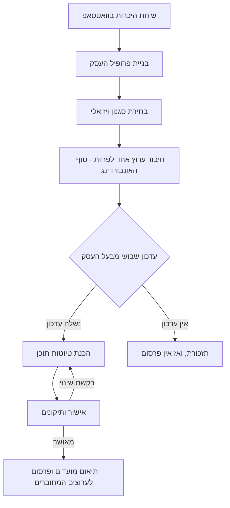
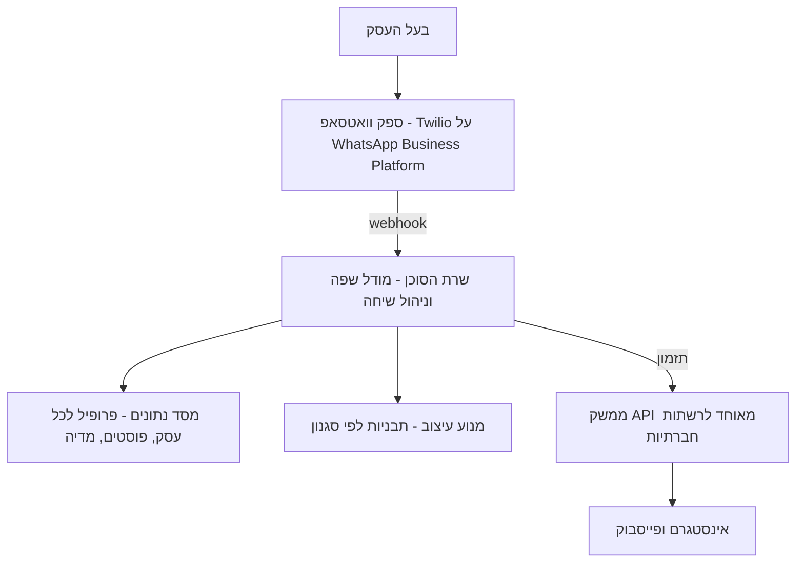

# אפיון מוצר: postly

סוכן בינה מלאכותית שמנהל אינסטגרם ופייסבוק לבעלי עסקים קטנים דרך וואטסאפ. האפיון מפרט את התהליך, את הקונטקסט שהסוכן מחזיק לכל עסק, את החלטות הארכיטקטורה, ומה הסוכן יודע ולא יודע לעשות בשלב הראשון.

## סקירת המוצר

המוצר postly הוא סוכן בינה מלאכותית שכותב, מעצב ומפרסם אוטומטית 2 עד 5 פוסטים בשבוע באינסטגרם ובפייסבוק עבור בעלי עסקים קטנים. כל התקשורת עם בעל העסק מתנהלת בוואטסאפ, כך שאין צורך באפליקציה או בממשק נוסף.

| נושא | הגדרה |
| --- | --- |
| קהל יעד | בעלי עסקים קטנים עצמאיים, בעיקר עם נוכחות חלשה או לא עקבית ברשתות החברתיות |
| ערוץ תקשורת | וואטסאפ, דרך ספק צד שלישי בשלב הראשון |
| ערוץ פרסום | אינסטגרם ופייסבוק בשלב הראשון, ומספיק שעסק יחבר אחד מהם; רשתות נוספות בהמשך |
| תפוקה | 2 עד 5 פוסטים בשבוע, לפי מה שנקבע בפרופיל העסק; כל פוסט מאושר עולה לכל הערוצים המחוברים ונספר כפוסט אחד |
| פרסום | דרך API מאוחד לרשתות חברתיות, מחובר לחשבון האינסטגרם העסקי ולעמוד הפייסבוק של הלקוח |
| עקרון מנחה | שום דבר לא עולה בלי אישור מפורש של בעל העסק |

## זרימת המוצר

## איך הסוכן עובד

החלטת האדם מ-5.11.2026; העיצוב המלא והחלטות האדם עליו ב-[agent.md](agent.md).

postly הוא **סוכן היברידי**. סוכן מבוסס מודל שפה עושה את החשיבה של השיחה: אוסף את פרטי העסק, שואל שאלות המשך כשתשובה עמומה או כשחסר פרט, מבקש תמונה, ויוצר ומתקן את הפוסטים. הוא פועל רק דרך סט קבוע של פעולות שנבדקות (כלים). הקוד מחליט על כל מה שאסור שישתבש: איזו הודעה באמת נשלחת ומתי, חלון 24 השעות והתבניות, בדיקת העובדות, האישור, התזמון, הרינדור והפרסום. הסוכן אף פעם לא שולח הודעה ולא מפרסם בעצמו, ושום דבר שהוא כותב לא נחשב אישור.

- **פרסונה.** הסוכנת מציגה את עצמה בשם "פוסטלי" ("Postly" באנגלית), סוכנת הסושיאל מבוססת ה-AI שלך, כמו בסרטון הדמו (הוחלט ב-5.11.2026). השם גלובלי; הצוות יכול לקבוע שם אחר לעסק מסוים. בעברית היא תמיד מדברת בלשון נקבה. השם שלה לא מופיע בפוסטים.
- **מגבלות.** לכל ריצה של הסוכן יש מגבלת צעדים, מגבלת עלות לריצה ולעסק ליום, מגבלת עלות יומית כוללת, ומגבלת זמן; אלה הגדרות שהצוות יכול לשנות (ערכי ההתחלה ב-[agent.md](agent.md#limits)). כשמגיעים למגבלה, או כשהסוכן לא בטוח, אדם מצוות postly ממשיך, ובעל העסק מקבל על כך הודעה.
- **הסוכנת תמיד פועלת.** אונבורדינג, העדכון השבועי והטיוטות רצים על הסוכנת לכל עסק, בלי מתג לתהליך או לעסק (הוחלט 6.11.2026). התהליכים הקבועים הקודמים נשארים בקוד רק לבדיקות, עד שניקוי יסיר אותם.

## אונבורדינג בוואטסאפ

1. פתיחה: הסוכן מציג את עצמו, מסביר איך זה עובד וכמה זמן ייקח האונבורדינג.
2. שיחת היכרות: הסוכן שואל שאלות בשפה פשוטה, אחת בכל פעם, שממלאות את שדות החובה בפרופיל העסק, שואל שאלת המשך על תשובה עמומה (למשל "איפה בדיוק?" או "עד איזו שעה?"), ומסיים בשאלה אם יש עוד משהו שלקוחות צריכים לדעת. אפשר לענות בטקסט או בהודעה קולית. הקוד מחליט מתי ידוע מספיק כדי להמשיך.
3. נכסי מותג: קבלת לוגו, תמונות של העסק והמוצרים, וצבעים או שפה עיצובית קיימת אם יש.
4. בחירת סגנון: הסוכן שולח פוסט לדוגמה על העסק עצמו בכל אחד משלושת הסגנונות, ובעל העסק בוחר אחד.
5. סיכום ואישור פרופיל: הסוכן שולח סיכום קצר של מה שהבין, ובעל העסק מתקן או מאשר.
6. חיבור הערוצים (שלב אחרון): חיבור ערוץ אחד לפחות דרך קישור: חשבון אינסטגרם עסקי, עמוד פייסבוק או שניהם, רגע לפני שמתחילים לפרסם. פירוט בסעיף החיבור לאינסטגרם ולפייסבוק.

חיבור הערוצים מגיע בסוף כדי שבעל העסק כבר ראה ערך בפוסטים לדוגמה לפני השלב הטכני המסורבל ביותר.

## פרופיל העסק: הקונטקסט שהסוכן מחזיק

לכל עסק נשמר פרופיל נפרד, ומידע של לקוח אחד לעולם לא משמש עסק אחר. הפרופיל בנוי משלושה חלקים: מה שבעל העסק חייב לתת, מה שיש לו ברירת מחדל, ומה שהסוכן לומד לבד לאורך הדרך.

### חובה מול ברירת מחדל

| שדה | מה שואלים | חובה | ברירת מחדל |
| --- | --- | --- | --- |
| שם ותחום העסק | מה העסק מוכר או נותן, ומה המוצרים המרכזיים | כן | אין |
| מיקום ושעות פעילות | עיר, כתובת, שעות ואיסוף או משלוח | כן | אין |
| קהל יעד | מי הלקוחות: גיל, שכונה או אזור, ולמה הם מגיעים | כן | תושבי האזור |
| מה מייחד את העסק | למה לקוחות בוחרים בו ולא במתחרה | כן | אין |
| שפת הפוסטים | עברית, ערבית, אנגלית, רוסית, או שילוב | לא | עברית |
| טון דיבור | רשמי, חם ומשפחתי, הומוריסטי; פנייה בלשון זכר, נקבה או רבים; שימוש באימוג'ים | לא | חם, פנייה ברבים |
| סוגי תוכן | מוצרים, מבצעים, מאחורי הקלעים, טיפים, חגים ואירועים, המלצות לקוחות | לא | שילוב מוצרים ומבצעים |
| פורמטים | פוסט בודד או קרוסלה | לא | פוסט בודד |
| ערוצי פרסום | אינסטגרם, פייסבוק או שניהם; מספיק ערוץ אחד | כן | אין |
| תדירות פרסום | כמה פוסטים בשבוע, בין 2 ל-5 | לא | 3 בשבוע |
| ימים ושעות פרסום | נשאל באונבורדינג: האם מפרסמים בשבת ובחגים, ובאילו ימים ושעות | לא | אין פרסום בשבת ובחגים |
| לוגו וצבעי מותג | קובץ לוגו וצבעים קבועים אם יש | לא | שם העסק בטקסט וצבעי הסגנון |
| סגנון ויזואלי | בחירה באחד משלושת הסגנונות | כן | אין |
| קריאה לפעולה | מה הלקוח צריך לעשות: להגיע, להתקשר, לשלוח הודעה, להזמין אונליין | לא | לבוא לחנות |
| פרטי יצירת קשר | טלפון, וואטסאפ, אתר או קישור להזמנה | לא | אין |
| שפות ונושאים אסורים | נושאים, מילים או מתחרים שלא מזכירים | לא | ללא פוליטיקה, ללא השוואה למתחרים |
| האשטגים קבועים | האשטגים של העסק או העיר | לא | הסוכן בוחר לפי תחום ומיקום |
| איש קשר מאשר | מספר אחד שמאשר פוסטים בוואטסאפ | כן | מי שעשה את האונבורדינג |

### קונטקסט שמתעדכן מעצמו

- היסטוריית פוסטים: מה פורסם, מתי ובאיזה ערוץ, כדי לא לחזור על אותו רעיון.
- העדפות מתיקונים: כל שינוי שבעל העסק ביקש (למשל בלי סימני קריאה, כיתוב קצר יותר) נשמר מיד ככלל להמשך. בהמשך אפשר יהיה להגדיר מה חד-פעמי ומה נשמר לזיכרון.
- מאגר תמונות של העסק לשימוש חוזר כשצריך.
- מצב שבועי: האם התקבל עדכון, כמה פוסטים מאושרים ומתוזמנים.

## סגנונות ויזואליים

| סגנון | מאפיינים |
| --- | --- |
| נקי | טיפוגרפיה בולטת, הרבה מרחב לבן, מעט אלמנטים |
| חם | צבעי אדמה וטקסטורות |
| דינמי | אלמנטים גרפיים בולטים ותחושת תנועה |

כל סגנון מוגדר כסט כללים קשיחים (צבעים, גופנים, מסגרות, מיקום כיתוב ולוגו) ומלווה בדוגמת פלט. העיצוב נבנה מתבניות קבועות ולא מיצירה חופשית, כדי לשמור על עקביות. למידה דינמית מסגנון קיים שמורה לשלב שני.

## חיבור לאינסטגרם ולפייסבוק

זה השלב האחרון באונבורדינג, ומתבצע רגע לפני הפרסום הראשון.

1. בחירת ערוצים: העסק מפעיל אינסטגרם, פייסבוק או שניהם, ומספיק ערוץ אחד.
2. הכנת החשבון: אם חשבון האינסטגרם אישי, הסוכן מדריך שלב אחר שלב, עם צילומי מסך, להעביר אותו לחשבון עסקי. אם העסק בחר בפייסבוק ואין לו עמוד, הסוכן מדריך לפתוח עמוד.
3. חיבור הערוצים: בעל העסק מקבל קישור ומאשר את החיבור ל-postly, בלי למסור סיסמה ובלי גישה לערוצים של לקוחות אחרים.
4. בדיקת חיבור: הסוכן מוודא שאפשר לתזמן פוסט לכל ערוץ שנבחר, ורק אז העסק עובר למצב פעיל. הבדיקה מבקשת מספק הפרסום לאמת תזמון של פוסט בחשבון, בלי לפרסם דבר.

## עדכון שבועי והכנת תוכן

פעם בשבוע בעל העסק שולח לסוכן בוואטסאפ מה חדש, למשל שהגיעו זרים חדשים או שיש מבצע על תמרים, בטקסט או בהודעה קולית, יחד עם תמונות.

- הסוכן קורא את העדכון, רושם כל עובדה עם המילים המדויקות של בעל העסק כמקור, ושואל שאלה ממוקדת אחת בכל פעם כשחסר פרט שפוסט צריך (למשל עד מתי המבצע) או כשלא הגיעה תמונה.
- הסוכן מחלק את העדכון למספר הפוסטים שנקבע בפרופיל, וכותב כיתוב והשטגים לכל אחד, מותאמים לכל ערוץ.
- כל פוסט בנוי על התמונה של בעל העסק, עם סט קבוע של עריכות: חיתוך, יישור, בהירות וניגודיות, פס כותרת בסגנון של העסק, תג אופציונלי (כמו "-15%" או "חדש"), והלוגו. תג עם מספר חייב להתאים לפרט שבעל העסק מסר. אין יצירת תמונות. העיצוב זהה בשני הערוצים, עם התאמה קלה של כיתוב וגודל.
- פוסט יכול להיות קרוסלה של 2 עד 10 שקופיות; הסוכן בוחר את הסדר ואת השער.
- אם חסר חומר, הסוכן משתמש בתמונות מהמאגר או שואל שאלה ממוקדת אחת.
- אם בעל העסק שולח כמה תמונות למה שבתוכנית הוא פוסט בודד, הסוכן שואל מה הוא רוצה: קרוסלה, תמונה אחת (השאר לא ייכנסו), או פוסט נפרד לכל תמונה.
- הטיוטות נשלחות לבעל העסק בוואטסאפ, והוא יכול לבקש שינויים במילים פשוטות עד שהוא מרוצה: הסוכן מחיל כל תיקון (כיתוב, כותרת, תג, עריכות תמונה, סדר שקופיות, או ערוץ אחד בלבד) ושולח את הגרסה החדשה.
- הנורמה היא עדכון אחד בשבוע. עדכון שני בזמן שהטיוטות עוד בהכנה מקבל תשובה שהסוכן עדיין עובד על הראשון; בזמן שיש טיוטות פתוחות הוא נחשב לבקשת שינוי בהן; ואחרי שהעדכון של השבוע כבר טופל הוא נחשב לעדכון של השבוע הבא.

### הגנות על התוכן

- מחיר, אחוז הנחה, תאריך, שעה, כתובת וטלפון מופיעים רק אם הגיעו מבעל העסק או מהפרופיל.
- קוד משווה את הפרטים בטיוטה למקור. אם משהו לא תואם, הטיוטה לא נשלחת, והסוכן מתקן אותה או שואל.
- אם חסר פרט, הסוכן שואל שאלה אחת, למשל עד מתי המבצע.
- המלצת לקוח מתפרסמת רק מטקסט שבעל העסק שלח.
- הפרטים העובדתיים מודגשים בטיוטה, כדי שיהיה קל לבדוק אותם לפני האישור.

## אישור ופרסום

- שום דבר לא עולה בלי אישור מפורש של בעל העסק.
- מתחת לכל טיוטה מופיעים כפתורי וואטסאפ: "מאשר" ו"לתקן". כל לחיצה מקושרת לגרסה מדויקת של הפוסט, וכל שינוי מבטל אישור קודם.
- הודעה חופשית כמו "סבבה" לא נחשבת אישור. הסוכן שולח שוב את הטיוטה עם הכפתורים.
- הודעה חופשית שמאשרת ומבקשת תיקון באותה נשימה, כמו "מושלם, רק תוסיף את השעות", היא תיקון: הסוכן מחיל אותו ושולח את הגרסה החדשה עם כפתורים, ובעל העסק לוחץ "מאשר" עוד פעם אחת. כל גרסה חדשה או מתוקנת צריכה לחיצה משלה.
- לחיצה אחת מאשרת את הפוסט לכל הערוצים המחוברים. בקשה לפרסם רק בערוץ אחד מטופלת כתיקון.
- לכל עסק יש בשלב הראשון מאשר אחד, והאישור מתקבל רק מהמספר שלו. החלפת מספר נעשית ידנית על ידי צוות postly.
- אחרי האישור, ורק אז, הסוכן מציע מועדי עלייה לפי הימים והשעות שבפרופיל, ובעל העסק מאשר או משנה. בלי נתוני ביצועים ההצעה אומרת שזו השעה הקבועה של בעל העסק; המלצה על השעות שבהן העוקבים הכי פעילים דורשת תוצאות עבר ותגיע בהמשך (WP-72).
- הסוכן מתזמן את הפוסטים, והם עולים דרך ה-API המאוחד לערוצים המחוברים בזמן שנקבע.
- אחרי עלייה הסוכן שולח אישור קצר בוואטסאפ בתבנית מאושרת, כי חלון 24 השעות לרוב כבר נסגר. אם העלייה נכשלה באחד הערוצים, הוא מודיע לבעל העסק ולצוות postly באיזה ערוץ זה קרה.

## שבוע בלי עדכון

אם בעל העסק לא שלח עדכון, הסוכן שולח תזכורת שבועית בתבנית מאושרת. אם גם אחריה לא מתקבל עדכון, באותו שבוע לא מתפרסם תוכן.

בוואטסאפ עסקי הודעה יזומה אחרי 24 שעות מההודעה האחרונה של הלקוח דורשת תבנית הודעה מאושרת. לכן התזכורת ואישורי הפרסום נבנים יחד עם ספק הוואטסאפ כבר בשלב הראשון. הצעות תוכן יזומות נשארות יכולת עתידית.

## תשלום, תמיכה וניתוק

- תשלום: אין תקופת ניסיון; בעל העסק משלם מיד. המחיר הוא 300 ₪ לחודש (הוחלט ב-2026-11-04), והוא נשמר בהגדרה אחת שהצוות יכול לשנות מהקונסולה, עם היסטוריה של כל שינוי; מחיר חדש חל על קישורי תשלום שנשלחים אחרי השינוי. כשהקליטה מסתיימת (הערוצים עברו בדיקה והעסק פעיל), הסוכן שולח קישור תשלום בוואטסאפ; התשלום מתבצע בדף של ספק הסליקה, ונשמרים רק מזהים וסטטוס. ספק הסליקה עדיין לא נבחר (PayPlus ו-Grow הם המועמדים), ובינתיים סימולטור תשלום עומד מאחורי שכבה פנימית.
- עצירה על אי תשלום (T16, 2026-11-05): בעל עסק שלא שילם מקבל תקופת חסד של 7 ימים. היא מתחילה כשנשלח קישור התשלום הראשון (`pending`), או כשחידוש נכשל (`past_due`). תזכורות בוואטסאפ יוצאות בימים 1, 3 ו-6, והפרסום ממשיך בתקופת החסד. ביום 7 הפרסום נעצר: העסק מושהה באותה השהיה שהצוות משתמש בה, בעל העסק מקבל הודעה, ושום דבר לא נמחק ולא מבוטל: הטיוטות, האישורים שכבר ניתנו, הפוסטים המתוזמנים וכל הנתונים נשמרים. בזמן ההשהיה, כמו בהשהיה של הצוות, אישורים חדשים ופרסום ממתינים. תשלום מחזיר את המנוי ל-`active`, מחדש את העסק, והפוסטים שחיכו מתפרסמים. השהיה שהצוות קבע לא מתבטלת בגלל תשלום.
- תמיכה: כשהסוכן נתקע, המייסד עונה בפיילוט, בשעות שיוגדרו.
- ביטול וניתוק: ניתוק הערוצים מיידי. ביטול אף פעם לא מוחק נתונים (החלטת האדם, 7.11.2026: "לשמור, להעביר לארכיון"). העסק נשאר מבוטל ולקריאה בלבד, ואחרי תקופת שמירה, 30 יום כברירת מחדל (זמני), הוא עובר לארכיון: בלי עיבוד ובלי הודעות, מוסתר מהרשימות הרגילות בקונסולה אבל אפשר לצפות בו, והנתונים שלו נשמרים.
- מחיקה לפי בקשה: הנתונים של עסק נמחקים רק כשבעל העסק מבקש זאת במפורש (ייתכן שדיני הפרטיות מחייבים). הצוות מבצע את המחיקה מהקונסולה, מקליד את שם העסק לאישור ורושם מי ביקש, מתי ובאיזה ערוץ. המחיקה מסירה את השורות והקבצים של העסק; יומן הביקורת של ה-workflow נשאר. זמני, עד שהאדם יאשר את הכלל עם ייעוץ משפטי (פריט 75 בתור הבדיקה).
- עצירה גלובלית: כפתור בקונסולה עוצר את כל הפרסומים באירועים ביטחוניים ובימי אבל.
- דוח חודשי: בעל העסק מקבל דוח ביצועים פשוט, אם ספק הפרסום מספק את הנתונים: בראשון לכל חודש, מספר הפוסטים שפורסמו בחודש הקודם, סך החשיפה וסך המעורבות (לייקים, תגובות ושיתופים). חודש בלי פוסט שפורסם, או בלי אף נתון מהספק, לא שולח כלום.

## ארכיטקטורה

### חיבור לוואטסאפ

החלטה: בשלב הראשון מתחברים לוואטסאפ דרך ספק צד שלישי שמורשה על ידי Meta (שותף BSP), על גבי WhatsApp Business Platform. ההמלצה היא Twilio, עם 360dialog כחלופה. בהמשך עוברים לחיבור ישיר ל-WhatsApp Cloud API של Meta דרך חשבון Meta Business של postly.

למה ספק צד שלישי עכשיו:

- הקמה מהירה: מספר, קבלת הודעות ושליחה דרך API פשוט ו-webhook.
- הספק מטפל באימות העסק, באישור תבניות ובמדיה (תמונות והודעות קוליות).
- דרך רשמית ומאושרת, בלי סיכון חסימה של וואטסאפ ווב לא רשמי.

מה משלמים על זה:

- תוספת עלות של הספק מעל התמחור של Meta.
- תלות בספק; מעבר ל-Meta ישירות ידרוש עבודת העברה.

כדי שהמעבר יהיה קל, הקוד של הסוכן מדבר עם שכבת הודעות פנימית אחת (שליחה, קבלה, מדיה), ורק היא מכירה את הספק. מספר הוואטסאפ של postly רשום מהיום הראשון בחשבון Meta Business של postly, כך שהמספר נשאר אותו מספר אחרי המעבר.

### חיבור לרשתות החברתיות

החלטה: בשלב הראשון מפרסמים דרך API מאוחד שמיועד למוצרים מרובי לקוחות. ההמלצה היא [Zernio](https://zernio.com/pricing), עם [Ayrshare](https://www.ayrshare.com/use-cases/saas-platforms/) כחלופה, בכפוף לבדיקה קצרה. אם העלויות יצדיקו זאת, אפשר לעבור בהמשך לחיבור ישיר ל-Graph API של Meta.

למה API מאוחד עכשיו:

- בעל העסק מחבר את הערוצים שלו בלי לקבל גישה לחשבון משותף של postly.
- אינטגרציה אחת מכסה את אינסטגרם ואת פייסבוק, וגם רשתות נוספות בהמשך.
- הספק מחזיק את אישורי האפליקציה מול הרשתות ומטפל בהרשאות.

מה משלמים על זה:

- עלות לכל לקוח, שעולה ככל שמחברים יותר ערוצים.
- תלות בספק; מעבר לספק אחר או ל-Meta ישירות ידרוש חיבור מחדש של הערוצים.

כדי שהמעבר יהיה קל, הקוד של הסוכן מדבר עם שכבת פרסום פנימית אחת (חיבור ערוץ, פרסום, בדיקת סטטוס), ורק היא מכירה את הספק.

### רכיבי המערכת

- שרת הסוכן מקבל הודעות מהספק, טוען את פרופיל העסק לפי מספר הטלפון, ומנהל את מצב השיחה.
- מסד הנתונים מפריד בין עסקים; כל קריאה למודל מקבלת רק את הקונטקסט של העסק הרלוונטי.
- מנוע העיצוב מרכיב תמונה, כיתוב ולוגו על תבנית קבועה, כדי שכל הפוסטים של העסק ייראו עקביים.
- ה-API המאוחד מחזיק את ההרשאות לחשבונות האינסטגרם ולעמודי הפייסבוק, ומפרסם בזמן שתוזמן.

## יכולות הסוכן

### יודע לעשות בשלב 1

- לנהל שיחת אונבורדינג בוואטסאפ ולמלא פרופיל עסק, עם שאלות המשך על תשובות עמומות.
- לשאול שאלת המשך ממוקדת אחת על פרט חסר או תמונה חסרה בעדכון השבועי.
- להבין טקסט, הודעות קוליות ותמונות מבעל העסק.
- לכתוב כיתובים והשטגים בשפה ובטון שנקבעו, ולהשתמש רק בפרטים עובדתיים שאומתו.
- לערוך את התמונות של בעל העסק בסט קבוע של פעולות (חיתוך, יישור, בהירות וניגודיות, פס כותרת, תג אופציונלי, סדר קרוסלה) לפי אחד משלושת הסגנונות.
- לשלוח טיוטות עם כפתורי אישור, לקבל תיקונים ולשמור אותם מיד ככללים.
- לתזמן פוסטים מאושרים לערוצים המחוברים ולדווח על עלייה או כישלון.
- לשלוח תזכורת שבועית ודוח חודשי פשוט.
- להדריך מעבר לחשבון אינסטגרם עסקי, פתיחת עמוד פייסבוק וחיבור הערוצים ל-postly.

### לא יודע לעשות בשלב 1

- לפרסם בלי אישור מפורש.
- להציע תוכן ביוזמתו.
- לקבל אישורים מיותר ממספר אחד לכל עסק.
- ללמוד סגנון מהאינסטגרם או מהפייסבוק הקיימים של העסק.
- ליצור תמונות מאפס, לשנות את מה שרואים בתמונה, או ליצור סרטונים.
- לפרסם ברשתות מלבד אינסטגרם ופייסבוק.
- לענות לתגובות או להודעות פרטיות באינסטגרם ובפייסבוק.
- לנהל פרסום ממומן.

| יכולת | שלב |
| --- | --- |
| אונבורדינג, פרופיל עסק וקונטקסט נפרד | שלב 1 |
| שלושה סגנונות מוגדרים עם דוגמאות | שלב 1 |
| חיבור ערוץ אחד לפחות בסוף האונבורדינג | שלב 1 |
| עדכון שבועי, טיוטות, תיקונים ואישור בכפתורים | שלב 1 |
| סוכן היברידי לאונבורדינג, איסוף המידע השבועי, טיוטות ותיקונים, דרך כלים שנבדקים | שלב 1 |
| עריכות תמונה מסט קבוע, אלמנט התג, וקרוסלות | שלב 1 |
| הגנות על פרטים עובדתיים והמלצות לקוחות | שלב 1 |
| תיאום מועדים ופרסום מתוזמן לאינסטגרם ולפייסבוק | שלב 1 |
| תזכורת שבועית ואישורי פרסום בתבניות מאושרות | שלב 1 |
| דוח חודשי פשוט, אם הספק מספק נתונים | שלב 1 |
| עצירה גלובלית של פרסומים | שלב 1 |
| וואטסאפ דרך ספק צד שלישי | שלב 1 |
| ריבוי מאשרים וגיבוי; בחינת הפרדה בין לקוחות עסקיים ליחידים | שלב 2 |
| הגדרה של מה חד-פעמי ומה נשמר לזיכרון | שלב 2 |
| למידה דינמית מסגנון קיים | שלב 2 |
| מעבר ל-WhatsApp Cloud API ישירות מ-Meta | שלב 2 |
| הצעות תוכן יזומות | עתידי |
| רשתות נוספות מעבר לאינסטגרם ולפייסבוק | עתידי |

## סיכונים ושאלות פתוחות

- מדיניות וואטסאפ היא הסיכון החמור ביותר: Meta אוסרת ספקי AI כשהטכנולוגיה היא הפונקציונליות העיקרית. צריך תשובה כתובה מהספק, סוכן שמוגבל לתהליך העבודה, מעבר לאדם וערוץ גיבוי.
- עקביות ויזואלית היא נקודת סיכון מרכזית; המענה הוא תבניות קשיחות ומנוע עיצוב שמרכיב לפי כללים.
- בשלב הראשון אין חיבור ישיר ל-API של הרשתות החברתיות; ספק ה-API המאוחד מטפל בהרשאות, ולכן נוצרת תלות בו.
- הערכה ראשונית לוואטסאפ ולפרסום היא כ-$6–10 ללקוח בחודש, לפני מודלים, תמלול, אחסון ותמיכה. המחיר של 300 ₪ עדיין לא אומת מול העלויות.
- חיבור הערוצים הוא השלב שבו בעלי עסקים עלולים לנשור; צריך הדרכה קצרה וברורה.

### שאלות פתוחות

- האם Gemini 3.5 Flash-Lite ו-20 הודעות היסטוריה מספיקים לסוכנת; ייבחן מחדש אם ההערכה הידנית או השימוש ב-dev יראו שזה חלש מדי ([agent.md](agent.md#decisions)).
- ספק סליקה: PayPlus ו-Grow הם המועמדים, ובינתיים נבנה מימוש זמני.
- מה כלול ב-300 ₪, והנוסחים של העצירה על אי תשלום (H6).
- שעות התמיכה בפיילוט, והתקופה מביטול עד העברה לארכיון (30 יום באופן זמני).
- תשובה כתובה על מדיניות וואטסאפ, והקמת ישות עסקית, אימות ב-Meta Business, מספר טלפון ותבניות.
- בדיקת Zernio ו-Ayrshare: חיבור בקישור, עברית, קרוסלה, התראות כישלון, נתוני ביצועים ותנאי שימוש.
- איכות מודלים ותמלול בעברית, ועלויות מלאות ללקוח.
- תנאי שימוש, פרטיות, אחריות על תוכן והסכמה לשימוש בתמונות.
- ניטור והתראות נדרשים, אבל עוד לא נבחר פתרון.
